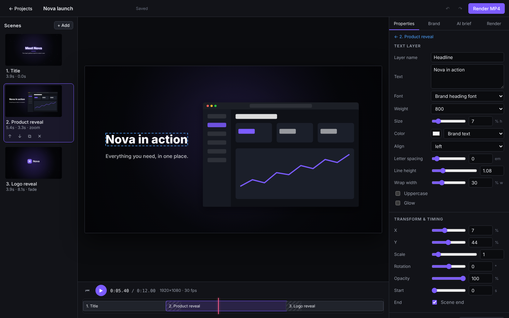

# SceneWright

**Open-source, AI-assisted, editable motion graphics.** Describe a video in a sentence,
get a multi-scene animation built from a validated scene graph, edit every text, color,
timing and animation, preview it live, and export an H.264 MP4 — with or without an AI key.



> Status: **v0.1 foundation.** The core workflow below is implemented and tested end to end.
> See [Verified features](#verified-features) and [Known limitations](#known-limitations).

## Why

Generative video tools hand you pixels you can't edit. Code-first motion tools make the AI
write executable code. SceneWright sits in between: the AI (or an offline planner) writes a
small **storyboard as data**, a deterministic compiler turns it into a **versioned project
file**, and one engine renders that file identically in the browser preview and the
exporter. Model output is never executed — it is validated against a strict schema and
anything unsupported is reported, not silently ignored.

## Quick start

Requirements: **Node.js 22+** and **FFmpeg with libx264** (`ffmpeg -encoders | grep libx264`).

```bash
npm install
npm run dev            # API on :8787 + editor on http://localhost:5173
```

Production-style (single port):

```bash
npm run build
npm start              # http://127.0.0.1:8787
```

Optional AI planning: copy `.env.example` to `.env` and set `ANTHROPIC_API_KEY`, or point
`OPENAI_BASE_URL`/`OPENAI_MODEL` at any OpenAI-compatible server (e.g. Ollama). Without
either, the built-in offline planner is used.

## Using it

1. **New project** — name it, pick a template (Product launch, Kinetic typography, Logo
   reveal, Blank), a format (16:9, 9:16, 1:1, 720p), frame rate and length, and write a brief.
   The Product launch template is pre-filled with the Nova example brief.
2. **Generate** — you get an editable multi-scene project and a report of which planner was
   used, any placeholder copy, and any requests that aren't supported yet.
3. **Edit** — click a scene, click a layer (or click/drag it in the preview); change text,
   fonts, colors (literal or brand tokens), position, timing, transitions, backgrounds and
   animations. Change **brand colors** once in the Brand tab and every layer using them
   updates. Upload screenshots/logos in the Brand tab and pick them on Screenshot/Logo layers.
   Undo/redo (Ctrl/Cmd+Z), Space to play. Edits autosave; invalid states are shown, not saved.
4. **Render** — the Render tab validates, renders, verifies the file with ffprobe and offers
   a player and download. **Export project bundle** gives you one `.scenewright.json` file
   with the project and its images, importable on any machine.

### Sample project from the command line

```bash
npm run validate -- examples/nova-launch.project.json
npm run render   -- examples/nova-launch.project.json out/nova.mp4
# Rendered …/out/nova.mp4  1920x1080 h264 yuv420p, 360 frames @ 30 fps, 12.000 s
```

To edit it in the UI: Projects → **Import…** → choose `examples/nova-launch.project.json`.

## Architecture

```
src/
  project/     schema (Zod, v1) · migrations · bundles · pure edit operations · colors
  engine/      timeline · easing · animation primitives · drawing · renderFrame (Canvas 2D)
  storyboard/  storyboard schema (AI contract) · moods · scene-kind compilers · templates
  ai/          PlannerProvider interface · heuristic (offline) · Anthropic · OpenAI-compatible · generate (validate + fallback)
  render/      Node env on @napi-rs/canvas (Skia) · FFmpeg streaming · ffprobe verification
  server/      Hono API · file storage · render job queue
  editor/      React 19 editor (Vite)
  cli/         render · validate
tests/         Vitest (81 tests)        e2e/  Playwright end-to-end workflow
research/      landscape · architecture decisions · competitive analysis · license audit
docs/          project format · rendering · extending · open-core boundary · JSON Schema
```

Why this stack, and what was rejected (Remotion's license, Motion Canvas' inactivity,
HyperFrames/Motionly's code-generation model, Next.js, databases, Docker…):
[research/ARCHITECTURE_DECISIONS.md](research/ARCHITECTURE_DECISIONS.md).

## Documentation

- [Project format](docs/PROJECT_FORMAT.md) and [JSON Schema](docs/project.schema.json)
- [Rendering workflow](docs/RENDERING.md)
- [Extending](docs/EXTENDING.md): new animation primitives, element types, scene kinds, AI providers, templates
- [Open-source core vs. hosted services](docs/OPEN_CORE.md)
- Research: [repository landscape](research/REPOSITORY_LANDSCAPE.md) ·
  [architecture](research/ARCHITECTURE_DECISIONS.md) ·
  [competitive analysis](research/COMPETITIVE_ANALYSIS.md) ·
  [license & dependency audit](research/LICENSE_AND_DEPENDENCY_AUDIT.md)

## Testing

```bash
npm run typecheck
npm test                 # unit + integration (renders real MP4s with FFmpeg)
npm run test:e2e         # browser end-to-end; set PW_CHROMIUM_PATH to use a preinstalled Chromium
```

The end-to-end test performs the milestone scenario with AI keys explicitly cleared: create
"Nova launch" from the brief → 3 editable scenes → change the headline → change the brand
color → play the preview → render → check the MP4 with ffprobe (H.264, 1280×720, 288 frames,
12 s) and check that the new brand color is present in the exported frames and the old one
is not → reopen the project → verify edits persisted → re-render.

## Verified features

Each item is covered by automated tests (and the UI items by the Playwright test or manual
browser checks during development):

- Project creation with name, dimensions, frame rate, target length and template.
- Brief → storyboard → project with the offline planner (deterministic, no network).
- AI planning via Anthropic (structured outputs, server-side refusal fallback) or any
  OpenAI-compatible endpoint; both adapters are tested against local fake endpoints. Invalid,
  oversized, unknown-key or failing AI output falls back to the offline planner with a reason.
- Elements: text (fonts, weight, size, color, alignment, spacing, wrapping, glow), shapes,
  images, logos (uploaded or generated monogram), product screenshots in browser/phone
  frames (placeholder UI when none uploaded), seeded particles.
- Animations: fade, slide, scale, zoom, rotate-in, typewriter, tracking-in, float, pulse,
  spin; 7 easings; start/end anchoring.
- Backgrounds: solid, linear (optionally rotating) and radial gradients with vignette.
- Scene transitions: fade, slide-left, slide-up, zoom, wipe (overlapping, NLE-style timing).
- Brand tokens, palette presets, contrast warning.
- Editor: scene list with live thumbnails, add/duplicate/reorder/delete scenes, layer list,
  property inspector, animation editor, click-to-select and drag-to-move in the preview,
  playback and scrubbing timeline, undo/redo, autosave with validation feedback.
- Image upload (PNG/JPEG/WebP, type checked by content), project list, delete, import/export
  bundles with embedded assets, plain project import.
- Rendering: validation before work, progress, cancellation, ffprobe verification, cleanup
  of partial files, clear errors for invalid projects, odd dimensions, missing assets and
  missing FFmpeg; CLI rendering of projects and bundles.

## Known limitations

- **No audio** (music, voice-over, beat sync) yet; exported videos are silent.
- **No 3D**, no camera moves, no generated footage/images; such requests are reported as
  unsupported.
- **Scene-based editing only**: no multitrack timeline or keyframe curves; animations are
  presets with parameters.
- Text layout is Canvas 2D: no RTL shaping guarantees, no rich text within one layer, only
  three bundled font families (Latin subset).
- The AI regenerates whole storyboards; targeted AI edits ("make scene 2 faster") are not
  implemented.
- Single-user, local server without authentication; bind it to localhost only.
- Rendering is single-threaded per job (~1× real time at 1080p30 on 4 vCPUs).
- Tested on Linux x64 only. The Anthropic adapter was tested against a local fake endpoint
  only — no live API call was made during development.

## Roadmap

1. **Audio track + beat-aware timing** — soundtrack asset muxed by FFmpeg; snap scene
   durations to detected beats.
2. **AI edit operations** — the model proposes validated patches (change text, timing,
   colors of specific scenes) instead of regenerating everything; diff preview before apply.
3. **Generated assets via ComfyUI** — `AssetProvider` interface; images/clips become editable
   layers; model license shown before generation.
4. Video clip layers (decode via FFmpeg), Lottie import.
5. Keyframe tracks for arbitrary properties; multitrack timeline view.
6. Faster export: parallel chunked rendering; browser-side export with WebCodecs/Mediabunny.
7. 3D layer (three.js) with a headless-Chromium capture backend.
8. Template/scene-kind packages for community contributions.

## Contributing

See [CONTRIBUTING.md](CONTRIBUTING.md).

## License

Apache-2.0 — see [LICENSE](LICENSE) and [NOTICE](NOTICE). Bundled fonts are OFL-1.1.
Dependency and model-license review: [research/LICENSE_AND_DEPENDENCY_AUDIT.md](research/LICENSE_AND_DEPENDENCY_AUDIT.md).
